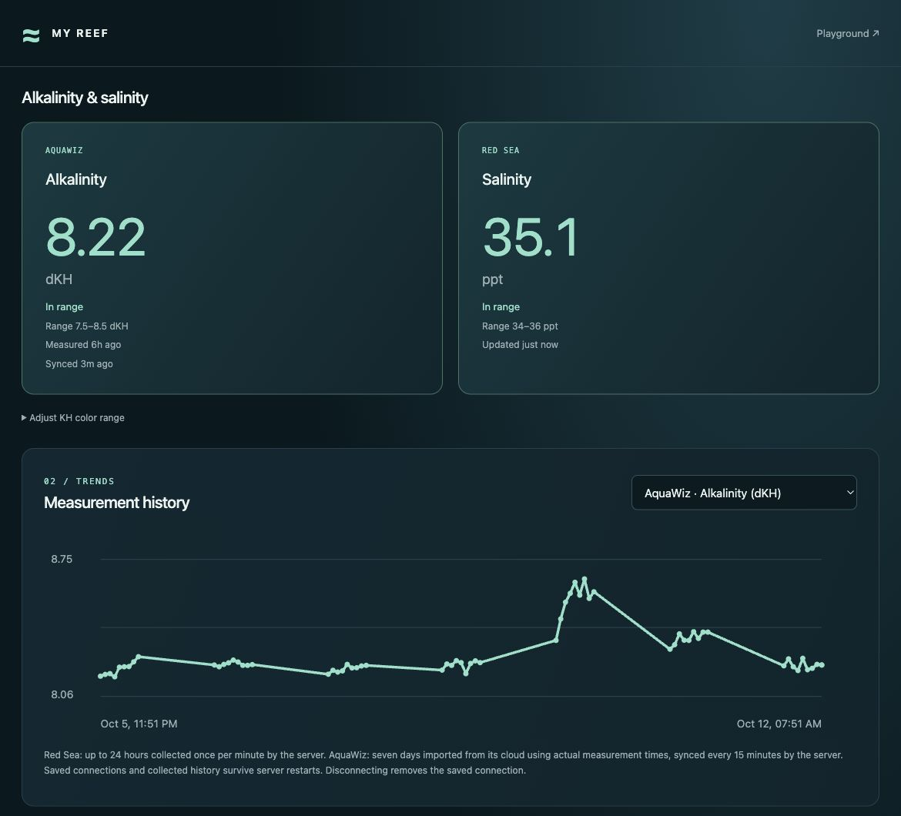
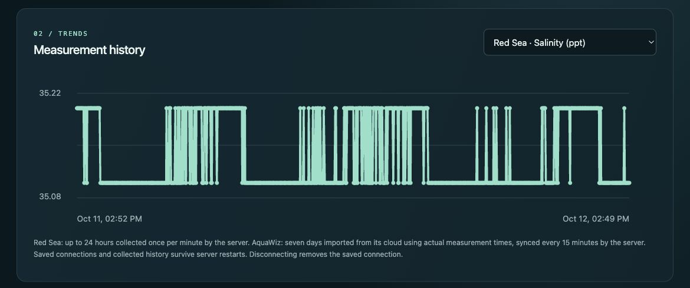

# My Reef

Your Red Sea ReefControl and AquaWiz alkalinity readings in one self-hosted dashboard.

Alkalinity and salinity sit side by side on phones and desktops, with green/red range colours, measurement timestamps and history. Install the dashboard on your home screen or desktop for its own app window. No Playground, Homebridge, Home Assistant or extra hub is required.

**Each installation belongs to one owner.** Share this repository so other reef keepers can run their own copy and connect their own accounts. Everyone signed into the same installation sees that owner's equipment; this is not a public service with separate user accounts.

## See it working

Real readings from the original owner's running dashboard, captured on 2026-10-12. Alkalinity and salinity are shown together, with their ranges, measurement times and alkalinity history:



Switch the history selector to see salinity collected by the server:



These screenshots come from the working Playground version. The standalone app has the same dashboard layout, with its own Sign out button in place of the Playground link. Account fields and equipment identifiers are outside the screenshots; no saved connections or private data files are included in this repository.

## Quick start

Install [Node.js 24 LTS](https://nodejs.org/en/download) (Node 22.9+ also works), then:

```sh
git clone https://github.com/rudovjan/my-reef.git
cd my-reef
npm run setup
npm start
```

There are no external runtime dependencies and no build step. Open **http://localhost:3000**. Read the password file at the location printed by setup (normally `~/.config/my-reef/password.txt`) and sign in. Connect Red Sea with your ReefBeat account and AquaWiz with its account. Either connection can be used independently.

Keep the server running to continue collecting readings. It polls Red Sea every minute and AquaWiz every 15 minutes even while the page is closed. Automatic refresh resumes when the browser or installed app becomes active again. AquaWiz measurement time and sync time are shown separately.

## Docker

With Docker and Compose installed:

```sh
docker compose up -d --build
docker compose exec my-reef cat /data/password.txt
```

Read the second command's output privately. Open **http://localhost:3000**. A named volume retains the password, browser sessions, encryption key, vendor connections and history through restarts and rebuilds. First startup creates a password only if one does not exist. The container runs as the unprivileged `node` user. The default port mapping is accessible only from the host computer.

```sh
docker compose down
docker compose up -d --build
```

These commands retain the volume. `docker compose down -v` deletes your saved data; do not use it for ordinary updates.

**Want it on your phone from anywhere?** Follow the [Docker + ngrok guide](docs/NGROK.md): run My Reef in Docker, tunnel its local port to your own HTTPS address, then add that address to your home screen. The guide includes setup, restarts, updates and troubleshooting.

## Phone and remote access

Use an HTTPS reverse proxy or tunnel to reach your server from another device. Copy `.env.example` to `.env` and set the exact origin, for example:

```dotenv
PUBLIC_ORIGIN=https://reef.example.com
```

Restart the app after changing this setting. Your proxy must preserve the original `Host` header and forward to the local app port. HTTPS is required for every remote origin; plain HTTP is supported only on loopback for local use. The app does not trust a browser-supplied forwarded host. `/healthz` supplies a simple health check without exposing equipment.

On iPhone, open your HTTPS address in Safari and use Share → Add to Home Screen. Supporting desktop and Android browsers also offer installation. The manifest and icons are included. Installation adds an app window; it does not run the server on your phone or keep phone JavaScript active in the background. Live data needs internet access; offline readings are not cached by a service worker.

Cloud reads work from a remote host. Red Sea's local-device fallback requires the server to reach the controller's private IP, so it is usually available only when running on your home network. Keep the encryption key and data on a persistent volume when using a hosting provider. [Hosting guide](docs/HOSTING.md)

## Configuration

Node commands load an optional `.env` file. Environment variables take precedence.

| Setting | Default | Purpose |
| --- | --- | --- |
| `PORT` | `3000` | HTTP server port |
| `HOST` | `127.0.0.1` | Bind address; set `0.0.0.0` inside a hosted container |
| `PUBLIC_ORIGIN` | `http://localhost:<port>` | Exact browser origin, including scheme and any nonstandard port |
| `MY_REEF_DATA_DIR` | `~/.config/my-reef` | Private persistent data directory |
| `REEF_POLLING` | enabled | `off` disables vendor polling for testing |

Set `MY_REEF_DATA_DIR` before both setup and startup. Keep it outside `public/`. Compose fixes the internal port to 3000 and data location to `/data`; its `.env` setting for `PUBLIC_ORIGIN` changes the external browser origin.

## Connections, data and passwords

Equipment passwords are used only for sign-in and are not stored. Vendor tokens, selected equipment, snapshots and history are encrypted with AES-256-GCM. The random key and vault remain in the private data directory with owner-only permissions. Browser APIs never return vendor passwords or tokens.

Browser login persists until logout, password rotation or browser data removal. Sign out revokes only that browser's login and retains the owner's equipment connections. The equipment Disconnect buttons remove the selected brand's saved connection for every signed-in browser on that installation. Password rotation revokes browser sessions and requires reconnecting equipment:

```sh
npm run setup -- --rotate
# Restart the server afterwards.
```

For Docker, use `docker compose exec my-reef node setup-password.mjs --rotate`, then `docker compose restart my-reef`.

Back up the **entire private data directory** together, including `reef-sessions.key`. Losing the key makes the encrypted vault unreadable. Keep backups private. `.gitignore` and `.dockerignore` exclude configuration, passwords, saved sessions, keys and data. Never upload these files with an issue or copy them into a public repository.

## Supported equipment and limits

- Red Sea ReefControl Pro/Lite discovered through ReefBeat. Reads available probes, ports and controller status. Salinity in ppt defaults to 34–36 inclusive; other units retain their actual device limits.
- AquaWiz KH controllers on the global or China cloud. Imports the latest alkalinity and seven days of cloud history. KH colours use an editable browser preference or the device's target ±0.5 dKH. Colour settings never alter equipment settings.
- Red Sea history retains up to 24 hours of server samples. AquaWiz history is deduplicated by actual measurement time; an old measurement is not made fresh by polling it again.
- Missing or stale readings remain neutral. Red Sea can renew a vendor-supplied refresh token. AquaWiz adopts new tokens when provided with readings; an expired or revoked connection may require another sign-in.
- Apex and Alkatronic are not implemented. This is a dashboard with read requests; it does not start tests, dose, calibrate or control equipment.

These are community integrations with vendor interfaces, not a vendor-supported API contract. The original owner's Red Sea and AquaWiz cloud readings were verified on 2026-10-11; other accounts and hardware must be checked through their own connection results. This repository includes no real account credentials, connection tokens or saved tank-data files. The screenshots above show selected readings shared by the owner. [Protocol notes and attribution](docs/PROTOCOLS.md)

## Development

```sh
npm test
```

Tests use temporary private data directories and mocked vendor responses. They cover standalone setup/authentication, persistent sessions, password rotation, encrypted vendor storage, polling, cloud conversion, range colours and browser refresh lifecycle. They do not log into real vendor accounts. GitHub Actions runs the suite on Node 22 and 24.

## License

[MIT](LICENSE). An independent community project, not affiliated with Red Sea or AquaWiz.
