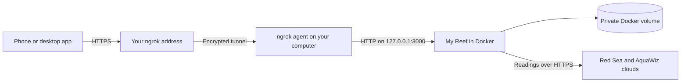

# Docker + ngrok: My Reef on your phone

Run My Reef on your computer or home server and use ngrok to give it an HTTPS address. You can open that address from your phone, including away from home, and install it on your home screen.



The computer runs the server, polls equipment and stores data. ngrok forwards browser traffic; it does not host a separate copy of the app. This setup runs **ngrok on the host computer**, outside the My Reef container. You do not need to open a port on your router or install Node on the host.

Each installation has one owner. Share the repository so others can run their own copy. Giving someone your app URL **and** its password lets them see your tank and manage its saved connections; it does not create a separate account for their equipment.

## 1. Install the tools

- Install [Docker with Compose](https://docs.docker.com/compose/install/) and start Docker.
- Install the ngrok CLI using the [official quickstart](https://ngrok.com/docs/gateway/endpoints/agent-cli-quickstart).
- Create your own ngrok account. Copy your assigned dev domain from [Domains](https://dashboard.ngrok.com/domains) and get your agent token from [Your Authtoken](https://dashboard.ngrok.com/get-started/your-authtoken).

Register the token on your own computer using ngrok's setup command:

```sh
ngrok config add-authtoken "YOUR_NGROK_AUTHTOKEN"
```

Replace the placeholder with your token privately. It is separate from the My Reef login password. Keep it in ngrok's private configuration, out of this repository, screenshots and support reports.

## 2. Set your public address

Download the source:

```sh
git clone https://github.com/rudovjan/my-reef.git
cd my-reef
```

If you have not created `.env` yet, copy the example:

```sh
cp .env.example .env
```

Edit `.env` and add this line, replacing the example with **your exact assigned HTTPS address**:

```dotenv
PUBLIC_ORIGIN=https://your-assigned-domain.ngrok-free.app
```

Use the scheme and hostname only, without a trailing slash or path. Some assigned domains end in `.ngrok-free.dev`; use the domain shown in your own account. The same URL must appear in the tunnel command below. `.env` is ignored by Git.

## 3. Start My Reef in Docker

From the repository directory:

```sh
docker compose up -d --build
docker compose ps
docker compose exec my-reef cat /data/password.txt
```

Read the password privately. First startup creates it and stores it in the named `my-reef-data` volume, alongside browser sessions, the encryption key, vendor connections and history. Restarts and rebuilds retain this volume.

The app's host port is bound to `127.0.0.1:3000`. Once you set an HTTPS `PUBLIC_ORIGIN`, open the dashboard through that HTTPS address: direct `http://localhost:3000` visits will no longer match the allowed host/origin. A local health check remains available:

```sh
curl http://127.0.0.1:3000/healthz
```

It should return `ok` without revealing equipment data.

## 4. Start the tunnel

In a second terminal on the **same computer**, replace the example URL with the address used in `.env`:

```sh
ngrok http http://127.0.0.1:3000 \
  --url https://your-assigned-domain.ngrok-free.app \
  --inspect=false
```

Leave this process running. The [CLI reference](https://ngrok.com/docs/gateway/agent/cli) documents `--url` and `--inspect`; this example disables the agent's HTTP inspection because login requests contain credentials. HTTPS traffic still passes through ngrok's service.

Preserve the incoming `Host` header. Do not add a host rewrite to `localhost` or `127.0.0.1`, including `--host-header=rewrite`, or My Reef will reject the request. My Reef validates the real `Host` and browser `Origin` against `PUBLIC_ORIGIN`.

Open your HTTPS ngrok address, sign in using the My Reef password and connect your own ReefBeat and AquaWiz accounts. The standalone dashboard lives at `/`, without a Playground path.

## 5. Add it to your home screen

On iPhone, open the HTTPS address in Safari and choose Share → Add to Home Screen. Supporting Android and desktop browsers offer an install option too. Keep the same ngrok address so your saved app shortcut continues to work.

Docker, the ngrok agent, the computer and its internet connection must stay running. Keep the computer awake. The server polls Red Sea every minute and AquaWiz every 15 minutes while the page is closed. The browser refreshes when it becomes active again; installing the app does not keep phone JavaScript running in the background.

## Restarts and updates

After rebooting, start Docker and ngrok again. Compose's `restart: unless-stopped` restarts the container when Docker is running, unless you deliberately stopped it. For unattended tunnelling, use ngrok's [background service guide](https://ngrok.com/docs/gateway/agent/service) for your operating system and configure the same public URL, upstream and disabled inspection.

To update your copy:

```sh
git pull --ff-only
docker compose up -d --build
```

After changing `PUBLIC_ORIGIN` in `.env`, run `docker compose up -d` to recreate the container with the new environment. `docker compose restart` alone does not load changed environment variables. Update the tunnel URL and home-screen shortcut if the public address changed.

`docker compose down` retains data. **`docker compose down -v` deletes the volume**, so do not use it for a normal restart or update. Back up the entire private volume, including `reef-sessions.key`, as described in the [README](../README.md#connections-data-and-passwords).

## Troubleshooting

| What you see | What to check |
| --- | --- |
| `Unrecognized host` | The tunnel URL and `.env` origin must match. Recreate the container after edits. Remove Host rewrites. Direct localhost dashboard visits are unavailable while configured for the HTTPS hostname. |
| `Invalid origin` at sign-in | Open the exact HTTPS address in `.env`, with no alternate hostname or plain HTTP. Recreate the container after changing it. |
| ngrok cannot reach the upstream | Start Docker, check `docker compose ps`, and run the local `/healthz` command. ngrok must run on the same host and forward to port 3000. |
| Port 3000 is already in use | Stop the conflicting service or change the host side of the Compose port mapping and the ngrok upstream port together. Keep the container port at 3000. |
| An ngrok welcome page appears | The free plan shows a browser interstitial before the app. It is separate from My Reef's login and can reappear according to ngrok's policy. |
| The app stops working when the computer sleeps | Keep the computer awake, Docker running and the tunnel connected. Installing a phone shortcut does not move the server onto the phone. |
| KH value is unchanged after syncing | Compare **Measured** with **Synced**. Polling imports the latest actual test; it does not run a new alkalinity test. |
| Equipment needs reconnecting after an update | Check that the same Docker volume was retained. Losing it or rotating the My Reef password requires reconnecting; vendor token expiry can also require sign-in. |

ngrok's free plan includes an assigned dev domain, HTTPS, usage limits and a browser interstitial. A dashboard left open can use its request allowance through regular refreshes. Check your account's usage and the current [free-plan limits](https://ngrok.com/docs/pricing-limits/free-plan-limits) before relying on it continuously. My Reef itself has no subscription fee; hosting and tunnel charges belong to your chosen providers.

Other HTTPS tunnels or a reverse proxy can work too, provided they preserve the public `Host` header and the configured origin. See the [hosting guide](HOSTING.md) for an always-running host or VPS.
